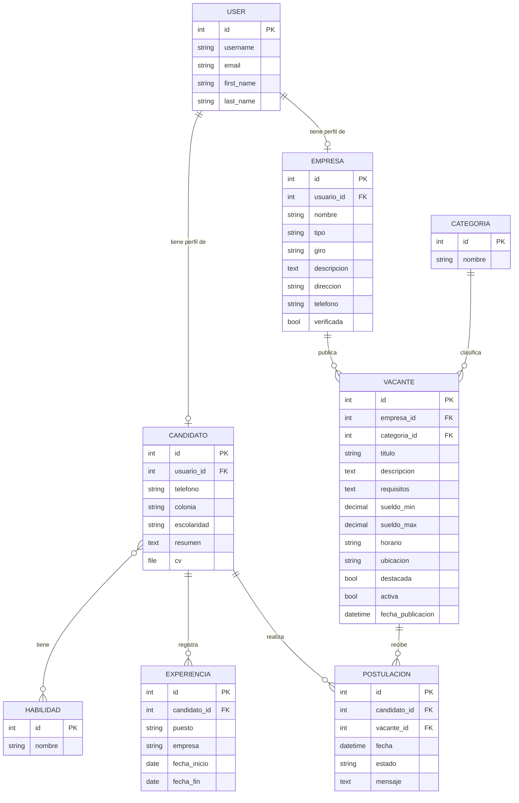

[README.md]
# Bolsa de Empleo Tizayuca

Plataforma web de bolsa de empleo para Tizayuca, Hidalgo y alrededores. Conecta a personas que buscan trabajo con empresas del parque industrial y negocios locales (barberías, panaderías, comercios), con la posibilidad de que el municipio verifique empresas y destaque vacantes.

Proyecto desarrollado con **Django** como parte de la materia en la UTVAM.

## Integrantes del equipo

| Nombre | Matrícula | Usuario de GitHub |
|---|---|---|
| Luis Rodrigo Martínez Hernández | 213110015 | [@RodrigoHdezMtz](https://github.com/RodrigoHdezMtz) |
| Najwa Harue Buenrostro Maldonado | 233110275 | [@HarueMaldonado](https://github.com/HarueMaldonado) |

---

## Estructura del proyecto

El proyecto está dividido en un proyecto principal y cuatro aplicaciones, cada una con una responsabilidad clara:

```
BolsaEmpleoTizayuca/
├── bolsa_empleo/        # Configuración principal (settings, urls)
├── candidatos/          # Perfiles de buscadores de empleo, experiencia y habilidades
├── empresas/            # Empresas y negocios que publican vacantes
├── vacantes/            # Vacantes, categorías y página pública de búsqueda
├── postulaciones/       # Relación entre candidatos y vacantes
├── cuentas/             # Panel, usuarios, grupos y permisos; piezas CRUD reutilizables
├── templates/           # base.html, login, plantillas CRUD genéricas
├── manage.py
└── requirements.txt
```

| App | Responsabilidad |
|---|---|
| `candidatos` | Perfil del buscador de empleo: datos de contacto, escolaridad, CV, habilidades y experiencia laboral |
| `empresas` | Perfil de la empresa o negocio: tipo (industrial / negocio local), giro, contacto y estado de verificación por el municipio |
| `vacantes` | Ofertas de trabajo con sueldo, horario, requisitos y categoría. Incluye la página de inicio con buscador |
| `postulaciones` | Registro de cada candidato que se postula a una vacante y el seguimiento de su estado |
| `cuentas` | Panel de inicio tras el login y gestión de `User`, `Group` y `Permission` desde la app (sin depender de `/admin`) |

---

## Documentación de la base de datos

### Diagrama entidad-relación



### Relaciones

| Relación | Tipo | Descripción |
|---|---|---|
| Usuario → Candidato | Uno a uno | Cada cuenta de usuario puede tener un perfil de candidato |
| Usuario → Empresa | Uno a uno | Cada cuenta de usuario puede tener un perfil de empresa |
| Candidato ↔ Habilidad | Muchos a muchos | Un candidato tiene varias habilidades y una habilidad la comparten varios candidatos |
| Candidato → Experiencia | Uno a muchos | Un candidato registra varias experiencias laborales |
| Empresa → Vacante | Uno a muchos | Una empresa publica varias vacantes |
| Categoría → Vacante | Uno a muchos | Cada vacante pertenece a una categoría (ej. Producción, Ventas) |
| Candidato → Postulación | Uno a muchos | Un candidato puede postularse a varias vacantes |
| Vacante → Postulación | Uno a muchos | Una vacante recibe varias postulaciones |

### Detalle de los modelos

#### `candidatos.Candidato`
| Campo | Tipo | Descripción |
|---|---|---|
| `usuario` | OneToOneField(User) | Cuenta de acceso del candidato. Se borra el perfil si se borra el usuario |
| `telefono` | CharField(15) | Teléfono de contacto (opcional) |
| `colonia` | CharField(100) | Colonia donde vive (opcional) |
| `escolaridad` | CharField(100) | Último grado de estudios (opcional) |
| `resumen` | TextField | Descripción breve del perfil (opcional) |
| `cv` | FileField | Currículum en archivo, se guarda en `cv/` (opcional) |
| `habilidades` | ManyToManyField(Habilidad) | Habilidades del candidato |

#### `candidatos.Habilidad`
| Campo | Tipo | Descripción |
|---|---|---|
| `nombre` | CharField(80), único | Nombre de la habilidad (ej. Montacargas, Excel, Atención al cliente) |

#### `candidatos.Experiencia`
| Campo | Tipo | Descripción |
|---|---|---|
| `candidato` | ForeignKey(Candidato) | Candidato al que pertenece |
| `puesto` | CharField(100) | Puesto que ocupó |
| `empresa` | CharField(150) | Empresa donde trabajó |
| `fecha_inicio` | DateField | Fecha de inicio |
| `fecha_fin` | DateField | Fecha de término; vacío si es su trabajo actual |

#### `empresas.Empresa`
| Campo | Tipo | Descripción |
|---|---|---|
| `usuario` | OneToOneField(User) | Cuenta de acceso de la empresa |
| `nombre` | CharField(150) | Nombre comercial |
| `tipo` | CharField(20), opciones | `industrial` o `local` (negocio local) |
| `giro` | CharField(100) | Actividad de la empresa |
| `descripcion` | TextField | Descripción de la empresa (opcional) |
| `direccion` | CharField(200) | Dirección |
| `telefono` | CharField(15) | Teléfono de contacto |
| `verificada` | BooleanField | Lo marca el municipio cuando valida que la empresa es real |

#### `vacantes.Categoria`
| Campo | Tipo | Descripción |
|---|---|---|
| `nombre` | CharField(80), único | Nombre de la categoría |

#### `vacantes.Vacante`
| Campo | Tipo | Descripción |
|---|---|---|
| `empresa` | ForeignKey(Empresa) | Empresa que publica la vacante |
| `categoria` | ForeignKey(Categoria), PROTECT | No se puede borrar una categoría que tenga vacantes |
| `titulo` | CharField(150) | Nombre del puesto |
| `descripcion` | TextField | Descripción del puesto |
| `requisitos` | TextField | Requisitos (opcional) |
| `sueldo_min` / `sueldo_max` | DecimalField | Rango de sueldo (opcional) |
| `horario` | CharField(100) | Horario de trabajo |
| `ubicacion` | CharField(200) | Lugar de trabajo |
| `destacada` | BooleanField | El municipio puede destacar vacantes para que salgan primero |
| `activa` | BooleanField | Solo las vacantes activas se muestran al público |
| `fecha_publicacion` | DateTimeField | Se llena automáticamente al crear la vacante |

#### `postulaciones.Postulacion`
| Campo | Tipo | Descripción |
|---|---|---|
| `candidato` | ForeignKey(Candidato) | Quién se postula |
| `vacante` | ForeignKey(Vacante) | A qué vacante |
| `fecha` | DateTimeField | Se llena automáticamente |
| `estado` | CharField(20), opciones | `enviada`, `vista`, `entrevista`, `aceptada` o `rechazada` |
| `mensaje` | TextField | Mensaje opcional del candidato |

**Restricción:** `postulacion_unica` impide que un mismo candidato se postule dos veces a la misma vacante.

---

## Migraciones

Cada app tiene su migración inicial en su carpeta `migrations/`:

| App | Migración |
|---|---|
| candidatos | `0001_initial.py` |
| empresas | `0001_initial.py` |
| vacantes | `0001_initial.py` |
| postulaciones | `0001_initial.py` |

---

## Cómo correr el proyecto

### Instalación automática (recomendada)

El script `instalar.sh` (macOS y Linux) hace los 5 pasos de instalación y deja el servicio web activo:

1. Crea el ambiente virtual (`.venv`)
2. Descarga el código fuente (si se ejecuta solo en una carpeta vacía lo baja con `git clone`; dentro del repositorio usa esos archivos)
3. Configura la base de datos y los usuarios (instala `requirements.txt`, `migrate`, `preparar_entorno` y 100 vacantes de ejemplo)
4. Instala y valida las herramientas de Django (`check` y migraciones)
5. Activa el servicio web y comprueba que responde

```bash
git clone https://github.com/UTVAM-Software/2026-III-Bolsa-de-Empleo-Tizayuca.git
cd 2026-III-Bolsa-de-Empleo-Tizayuca
./instalar.sh
```

Al terminar imprime la dirección (por defecto http://127.0.0.1:8000) y las cuentas de acceso. Si el puerto está ocupado usa el siguiente; se puede elegir con `PUERTO=8080 ./instalar.sh`. Se puede correr varias veces sin duplicar datos y `./instalar.sh --detener` apaga el servicio. Si falla un paso se detiene con un mensaje de error y código de salida distinto de cero.

### Instalación manual

**Requisitos:** Python 3.12 o superior y git. El repositorio solo contiene el código: no incluye ambiente virtual, base de datos ni archivos subidos. Cada quien crea su ambiente local con los pasos de abajo.

```bash
# 1. Clonar el repositorio
git clone <URL-del-repositorio>
cd BolsaEmpleoTizayuca

# 2. Crear y activar el ambiente virtual propio
python3 -m venv .venv
source .venv/bin/activate               # En Windows: .venv\Scripts\activate

# 3. Instalar dependencias
pip install -r requirements.txt

# 4. Crear la base de datos local (SQLite)
python manage.py migrate

# 5. Preparar el ambiente: roles, categorías y cuentas de administrador y profesor
python manage.py preparar_entorno

# 6. Correr el servidor
python manage.py runserver
```

Opcional: `python manage.py poblar_vacantes` crea 1000 vacantes de prueba (`--cantidad 5000` o `--borrar`) y `python manage.py test` corre las pruebas.

### Funciones para el público
- **Registro** en `/panel/registro/` (nombre, correo y contraseña): la persona elige si busca empleo o si es empresa y queda en el grupo correspondiente (nunca en uno de administración).
- **Detalle de vacante** en `/vacantes/<id>/` y botón **Postularme** (una sola vez por vacante).
- **Cambio de contraseña** desde el menú.

### Acceso y matrícula
- Se entra con el **correo electrónico** y la contraseña (no hay "usuario" que inventar). El correo no se puede repetir, sin importar mayúsculas o minúsculas, y la base de datos también lo rechaza (índice único en `auth_user`).
- Cada cuenta recibe una **matrícula automática** con formato `TZY-AÑO-NNNNN` (por ejemplo `TZY-2026-00012`). Es única, consecutiva y se ve en el panel de la persona y en la lista de usuarios (`/panel/usuarios/`), donde también se puede buscar. Las cuentas que ya existían recibieron la suya con la migración `cuentas/0001_matricula.py`.
- Las cuentas antiguas sin correo (por ejemplo la de `createsuperuser`) todavía pueden entrar con su nombre de usuario.

### Cuentas que crea `preparar_entorno`
| Correo | Rol | Contraseña inicial |
|---|---|---|
| `admin@example.com` | Administradores | `Tizayuca.2026` |
| `profesor@example.com` | Solo lectura | `Tizayuca.2026` |

Son cuentas para uso local; cambia la contraseña con `--password OtraClave` al ejecutar el comando.

### Configuración (variables de entorno, todas opcionales)
Sin configurar nada funciona en modo desarrollo. Para un despliegue real:

| Variable | Valor por defecto | Uso |
|---|---|---|
| `DJANGO_SECRET_KEY` | clave de desarrollo | Clave secreta; obligatoria en producción |
| `DJANGO_DEBUG` | `1` | Pon `0` en producción |
| `DJANGO_ALLOWED_HOSTS` | `localhost,127.0.0.1` | Dominios permitidos separados por coma |

- Sitio público: http://127.0.0.1:8000
- Iniciar sesión: http://127.0.0.1:8000/cuentas/login/
- Panel (tras iniciar sesión): http://127.0.0.1:8000/panel/
- Admin de Django: http://127.0.0.1:8000/admin

---

## Autenticación, CRUD y control de accesos (Entregable 03-B)

### Login y logout
Se usan las vistas de `django.contrib.auth` en `/cuentas/login/` y `/cuentas/logout/` (logout por POST).
`LOGIN_REDIRECT_URL = 'cuentas:panel'` y `LOGOUT_REDIRECT_URL = 'vacantes:inicio'`.

### Rutas CRUD
| Módulo | Listado | Crear | Editar | Eliminar |
|---|---|---|---|---|
| Vacantes | `/gestion/vacantes/` | `nueva/` | `<id>/editar/` | `<id>/eliminar/` |
| Categorías | `/gestion/categorias/` | `nueva/` | `<id>/editar/` | `<id>/eliminar/` |
| Empresas | `/empresas/` | `nueva/` | `<id>/editar/` | `<id>/eliminar/` |
| Candidatos | `/candidatos/` | `nuevo/` | `<id>/editar/` | `<id>/eliminar/` |
| Habilidades | `/candidatos/habilidades/` | `nueva/` | `<id>/editar/` | `<id>/eliminar/` |
| Experiencia | `/candidatos/experiencia/` | `nueva/` | `<id>/editar/` | `<id>/eliminar/` |
| Postulaciones | `/postulaciones/` | `nueva/` | `<id>/editar/` | `<id>/eliminar/` |
| Usuarios | `/panel/usuarios/` | `nuevo/` | `<id>/editar/` y `<id>/contrasena/` | `<id>/eliminar/` |
| Grupos | `/panel/grupos/` | `nuevo/` | `<id>/editar/` | `<id>/eliminar/` |
| Permisos | `/panel/permisos/` | `nuevo/` | `<id>/editar/` | `<id>/eliminar/` |

Todos los listados están **paginados** (20 por página; 12 en la página pública) y tienen buscador, para que el sistema siga respondiendo con miles de registros.

### Roles
| Grupo | Qué puede hacer |
|---|---|
| Administradores (municipio) | Todo: todos los CRUD, usuarios, grupos, permisos, verificar y destacar |
| Solo lectura (profesor) | Consultar todos los módulos y registros sin poder crear, editar ni borrar nada |
| Empresas | Registrar **su** empresa, publicar y administrar **sus** vacantes, cambiar el estado de las postulaciones que les llegan |
| Candidatos | Llenar **su** perfil y experiencia, postularse a vacantes y ver **sus** postulaciones |

### Medidas de seguridad adicionales
| Riesgo | Medida |
|---|---|
| Fuerza bruta (A07) | Bloqueo de 15 min tras 5 intentos fallidos por usuario e IP; mismo mensaje para usuario inexistente o contraseña mala |
| Contraseñas débiles (A07) | Validadores de Django (largo mínimo, comunes, solo números) también en el registro |
| Datos personales (A01) | Los CV **no** tienen URL pública: se descargan en `/candidatos/<id>/cv/` solo por su dueño, el municipio, el perfil de solo lectura o la empresa a cuya vacante se postuló |
| Archivos subidos (A04/A08) | Solo PDF de hasta 2 MB, con revisión de la firma `%PDF-` y nombre aleatorio en disco |
| Escalada de privilegios (A01) | El registro público solo permite los roles Candidatos y Empresas |
| Configuración (A05) | Secretos por variables de entorno; con `DJANGO_DEBUG=0` se fuerza HTTPS, cookies seguras, HSTS y se exige `DJANGO_SECRET_KEY`; `X-Frame-Options: DENY`, `nosniff` y política de referrer |
| Inyección y XSS (A03) | ORM de Django (sin SQL manual) y autoescape de plantillas |
| CSRF | Token en todos los formularios; cierre de sesión y postulación solo por POST |
| Errores | Páginas 403, 404 y 500 propias, sin detalles internos |

`DJANGO_DEBUG=0 python manage.py check --deploy` no reporta problemas.

### Mitigación de OWASP A01:2021 – Broken Access Control
1. **Autenticación:** todas las vistas de gestión heredan `LoginRequiredMixin` (o usan `@login_required`). Sin sesión, redirigen al login.
2. **Autorización vertical:** cada vista declara `PermissionRequiredMixin` con su `permission_required` explícito (`app.view_`, `add_`, `change_`, `delete_`). Sin el permiso, responde **403**, aunque se escriba la URL a mano o se mande un POST directo.
3. **Autorización horizontal (IDOR):** `PropietarioMixin` filtra el queryset por dueño (`usuario`, `candidato__usuario`, `vacante__empresa__usuario`). Si una empresa cambia el número en `/gestion/vacantes/15/editar/` por una vacante ajena, recibe **404**.
4. **Campos protegidos:** una empresa no puede marcarse como verificada ni destacar sus vacantes; un candidato no cambia el estado de su postulación; solo un superusuario puede crear o editar superusuarios; nadie puede borrar su propia cuenta.
5. **Plantillas:** los botones y el menú se muestran según `perms`, pero la seguridad real está en las vistas.

### Propiedades y métodos de modelo
- `Vacante`: `rango_sueldo`, `dias_publicada`, `total_postulaciones` (`@property`), `desactivar()`, `get_absolute_url()`
- `Categoria`: `vacantes_activas`
- `Empresa`: `vacantes_activas`, `estado_verificacion`, `get_absolute_url()`
- `Candidato`: `nombre_completo`, `anios_experiencia`, `get_absolute_url()`
- `Experiencia`: `es_actual`, `duracion_meses`, `get_absolute_url()`
- `Postulacion`: `esta_abierta`, `marcar_vista()`, `get_absolute_url()`

### Pruebas automáticas
```bash
python manage.py test
```
52 pruebas: login/logout, que **cada URL** del sistema redirija al login sin sesión, que un rol sin permiso reciba 403, que no se pueda abrir el registro de otro usuario (404), el CRUD de usuarios/grupos/permisos y la prueba de carga con 1000 vacantes.

---

## Flujo de trabajo en Git

- La rama `main` contiene siempre la versión estable.
- Cada integrante trabaja en su propia rama (por ejemplo `feature/registro-candidatos` o `docs/readme`).
- Los cambios se suben a GitHub y se integran a `main` mediante **Pull Request**, que revisa otro integrante antes de fusionar.
